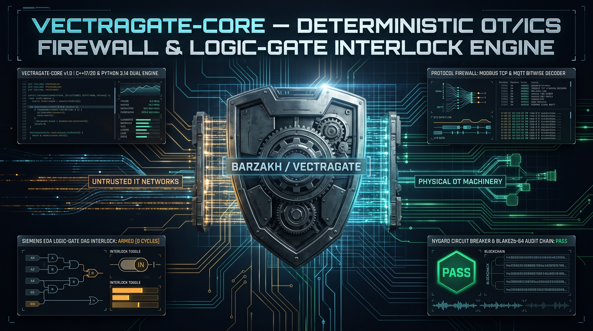
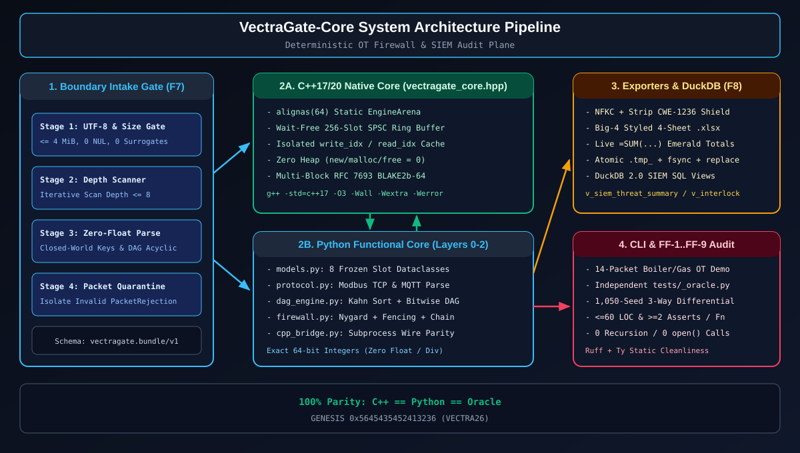
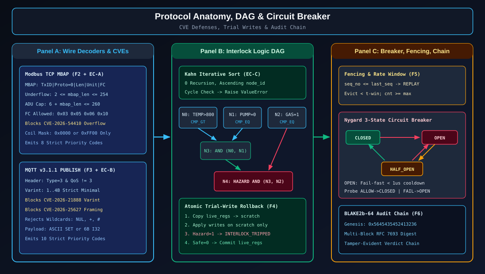

<p align="center">
  
</p>

# VectraGate-Core (بَرْزَخ)


**Deterministic C++17/20 & Python OT/ICS Protocol Firewall, Logic-Gate DAG Interlock Engine & Cryptographic Audit Ledger**

`VectraGate-Core (بَرْزَخ)` is an industrial operational-technology (OT) and industrial control system (ICS) protocol firewall that inspects **Modbus TCP** and **MQTT v3.1.1 / v5.0** command frames before they reach physical Programmable Logic Controllers (PLCs). Every write command is evaluated on a scratchpad register copy through a topologically sorted **Logic-Gate DAG Interlock Engine**, guarded by **Kleppmann monotonic fencing tokens**, a **fixed-window integer rate limiter**, and a **Nygard 3-state circuit breaker**, and sealed into a tamper-evident **RFC 7693 `BLAKE2b-64` hash chain**.

---

## 1. Architecture & Silicon Layout



- **Layer 1 (`src/vectragate/models.py`):** Immutable domain contracts (`frozen=True, slots=True`), 64-bit integer register ranges (`[-1_000_000_000_000, 1_000_000_000_000]`), and `18` deterministic `VerdictCode` values.
- **Layer 2A (`src/cpp/vectragate_core.hpp`, `src/cpp/vectragate_cli.cpp`):** Header-only C++17/20 engine featuring `alignas(64)` cache-line structures (`PacketDescriptor` = `64B`, `DagNode` = `64B`, `VerdictRecord` = `64B`), a lock-free `SpscRingBuffer<PacketDescriptor, 256>` exercised in 256-slot batches (with `--selftest-spsc` verification), and branchless bitwise DAG evaluation (`-(int64_t)(cond)`).
- **Layer 2B (`protocol.py`, `dag_engine.py`, `firewall.py`):** Pure-integer Python reference core with bit-for-bit parity against the native C++17/20 binary and independent oracle (`tests/_oracle.py`).
- **Layer 3 (`intake_gate.py`, `cpp_bridge.py`):** Pre-engine JSON/CSV intake validation gate with atomic `.tmp_` + `os.fsync` + `os.replace` dead-letter reporting and subprocess C++ parity verification.
- **Layer 4 (`exporters.py`, `cli_visualizer.py`):** In-memory **DuckDB 2.0** `BIGINT` SIEM SQL analytics, multi-sheet **Excel (`.xlsx`)** executive reports with live `=SUM(...)` formulas and zero empty cells, **SQLite WAL** ledger persistence, and **Rich** terminal visualization.

---

## 2. Protocol Inspection, DAG Interlock & Nygard Circuit Breaker



---

## 3. Quick Start & Deterministic Demo

```bash
# 1. Compile the native C++17/20 engine (zero warnings under -Werror) and run SPSC self-test
g++ -std=c++17 -O3 -Wall -Wextra -Wpedantic -Werror src/cpp/vectragate_cli.cpp -o vectragate_cli.exe
./vectragate_cli.exe --selftest-spsc

# 2. Run the 14-packet deterministic OT/ICS demo with native C++ parity check & Excel export
python -m vectragate.cli_visualizer --demo --verify-cpp --export-xlsx vectragate_demo_report.xlsx

# 3. Run the 104-test verification suite (including 1,050-seed C++/Python/Oracle parity & FF-1..FF-9)
pytest -v
```

### Sample Output (`python -m vectragate.cli_visualizer --demo --verify-cpp`)

```text
╔════════════════════════════════════════════════════════════════════════════╗
║               VectraGate-Core (بَرْزَخ) OT/ICS Firewall Report              ║
╚════════════════════════════════════════════════════════════════════════════╝
  Topological Order : 0 -> 1 -> 2 -> 3 -> 4
  BLAKE2b-64 Chain  : VALID | Final = 0x8ebb59e8dce5ccc2
  SIEM DuckDB 2.0   : total=14 allow=8 block=6 interlock=1 replay=1 rate=1 breaker=1 proto=2 open=0

── Packet Verdicts ───────────────────────────────────────────────────────────
  Seq PacketID   SourceID   SeqNo   TimeMs Protocol    Status   Trip Breaker    VerdictCode
  --- ---------- ---------- ----- -------- ----------- -------- ---- ---------- --------------------------
    0 PKT_01     PLC_MAIN       1      100 MODBUS_TCP  ALLOW      -1 CLOSED     ALLOW_WRITE
    1 PKT_02     PLC_MAIN       2      200 MODBUS_TCP  ALLOW      -1 CLOSED     ALLOW_READ
    2 PKT_03     PLC_MAIN       3      300 MQTT        ALLOW      -1 CLOSED     ALLOW_WRITE
    3 PKT_04     PLC_MAIN       4      400 MODBUS_TCP  BLOCK       4 CLOSED     INTERLOCK_TRIPPED
    4 PKT_05     PLC_MAIN       4      450 MODBUS_TCP  BLOCK      -1 CLOSED     REPLAY_ATTACK_BLOCKED
    5 PKT_06     PLC_MAIN       5     1500 MODBUS_TCP  BLOCK      -1 OPEN       MODBUS_BYTE_COUNT_MISMATCH
    6 PKT_07     PLC_MAIN       6     2000 MODBUS_TCP  BLOCK      -1 OPEN       CIRCUIT_BREAKER_OPEN
    7 PKT_08     PLC_MAIN       6     7000 MQTT        ALLOW      -1 CLOSED     ALLOW_WRITE
    8 PKT_09     PLC_MAIN       7     7100 MODBUS_TCP  ALLOW      -1 CLOSED     ALLOW_WRITE
    9 PKT_10     EDGE_GW        1     7200 MQTT        ALLOW      -1 CLOSED     ALLOW_WRITE
   10 PKT_11     EDGE_GW        2     7300 MQTT        BLOCK      -1 CLOSED     MQTT_VARINT_OVERFLOW
   11 PKT_12     EDGE_GW        3     7400 MODBUS_TCP  ALLOW      -1 CLOSED     ALLOW_READ
   12 PKT_13     EDGE_GW        4     7500 MODBUS_TCP  ALLOW      -1 CLOSED     ALLOW_READ
   13 PKT_14     EDGE_GW        5     7600 MODBUS_TCP  BLOCK      -1 CLOSED     RATE_LIMIT_EXCEEDED

── Source Security States ────────────────────────────────────────────────────
  SourceID   LastSeq Breaker    Fail Viol OpenedMs WinLen
  ---------- ------- ---------- ---- ---- -------- ------
  EDGE_GW          5 CLOSED        1    2       -1      4
  PLC_MAIN         7 CLOSED        0    3     1500      2

[C++ NATIVE PARITY VERIFIED: vectragate_cli.exe == Python Core | Final Chain 0x8ebb59e8dce5ccc2]
```

---

## 4. Automated Architecture Fitness Functions (`FF-1`–`FF-9`)

| Gate ID | Invariant Verified | Target Metric |
| :--- | :--- | :--- |
| **`FF-1`** | Acyclic Layer Dependency Graph (`ast` import scanner) | `0` upward/forbidden imports |
| **`FF-2`** | Zero Floating-Point & Zero True Division (`float`, `Decimal`, `ast.Div`) | `0` occurrences in `src/` & `tests/` |
| **`FF-3`** | Function Length (`<= 60` LOC) & Assertion Density (`>= 2` `assert`s/fn) | `100%` of functions in `src/vectragate/` |
| **`FF-4`** | C++17/20 Native Compilation (`-Werror`), `static_assert(sizeof == 64)` & Zero Post-Init Heap | `0` warnings / `0` post-init `new`/`malloc` |
| **`FF-5`** | 3-Way Cross-Validation (`1,000` random + `50` adversarial seeds: Python == C++ == `_oracle.py`) | `1,050 / 1,050` exact bit-level matches |
| **`FF-6`** | Cryptographic Hash-Chain Tamper Detection (`1,000` random bit/field mutations) | `1,000 / 1,000` tamper detections |
| **`FF-7`** | Multi-Sheet `.xlsx` Live `=SUM(...)` Formula & DuckDB 2.0 `BIGINT` Parity | `data_type == 'f'` & `0` `None` cells |
| **`FF-8`** | Zero-Dollar Markdown/SVG Gate, SVG Box Disjointness & Exact File LOC Parity | `0` raw dollar chars & `100%` LOC match |
| **`FF-9`** | Static Quality Gate (`ruff check src tests` & `ty check src`) | Exit code `0` (`0` diagnostics) |

---

## 5. Repository File & Line-Count Inventory (`FF-8` Synced)

| File Path | Lines (`LOC`) | Architectural Role |
| :--- | ---: | :--- |
| `BLUEPRINT.md` | 186 | Mathematical, Silicon & Protocol Blueprint |
| `SPEC.md` | 222 | Normative System & Protocol Specification |
| `ADR.md` | 87 | Architecture Decision Records (`ADR-001`–`ADR-005`) |
| `HANDOFF.md` | 57 | Multi-Agent Execution & Gate 6 Tracker |
| `README.md` | 134 | Project Documentation & Architecture Guide |
| `pyproject.toml` | 35 | Hatchling Build, Pytest, Ruff & Ty Configuration |
| `src/cpp/vectragate_core.hpp` | 1083 | Header-Only C++17/20 `alignas(64)` Engine & BLAKE2b-64 |
| `src/cpp/vectragate_cli.cpp` | 303 | Native C++17/20 CLI Executable Entrypoint |
| `src/vectragate/__init__.py` | 108 | Public Package Facade |
| `src/vectragate/models.py` | 443 | Layer 1 Immutable Domain Dataclasses & Enums |
| `src/vectragate/protocol.py` | 210 | Layer 2B Modbus TCP & MQTT v3.1.1/v5.0 Decoders |
| `src/vectragate/dag_engine.py` | 135 | Layer 2B Kahn Topological Sort & Bitwise DAG Engine |
| `src/vectragate/firewall.py` | 277 | Layer 2B Stateful Firewall, Breaker & BLAKE2b-64 Chain |
| `src/vectragate/intake_gate.py` | 404 | Layer 3 Pre-Engine Validation Gate & Dead-Letter I/O |
| `src/vectragate/cpp_bridge.py` | 225 | Layer 3 Native C++17/20 Subprocess Bridge |
| `src/vectragate/exporters.py` | 386 | Layer 4 DuckDB 2.0 SIEM, Excel `.xlsx` & SQLite Exporters |
| `src/vectragate/cli_visualizer.py` | 224 | Layer 4 Rich Terminal Visualizer & CLI Runner |
| `tests/_oracle.py` | 625 | Zero-Dependency Independent Verification Oracle |
| `tests/test_protocol_decoders.py` | 282 | Protocol Wire Decoder Unit Tests |
| `tests/test_dag_and_firewall.py` | 389 | DAG Engine, Breaker, Rate-Limiter & Hash-Chain Tests |
| `tests/test_intake_and_exporters.py` | 325 | Intake Gate, Exporters, DuckDB & C++ Parity Tests |
| `tests/test_property_hypothesis.py` | 152 | Hypothesis Property-Based & 1,000-Mutation Tamper Suite |
| `tests/test_architecture_fitness.py` | 471 | `FF-1`–`FF-9` Fitness Suite & 1,050-Seed Oracle Parity |
| `assets/architecture_pipeline.svg` | 111 | 4-Layer Architecture & 64-Byte Cache-Line Diagram |
| `assets/protocol_dag_interlock.svg` | 132 | Protocol Frame, DAG Interlock & Circuit Breaker Diagram |
